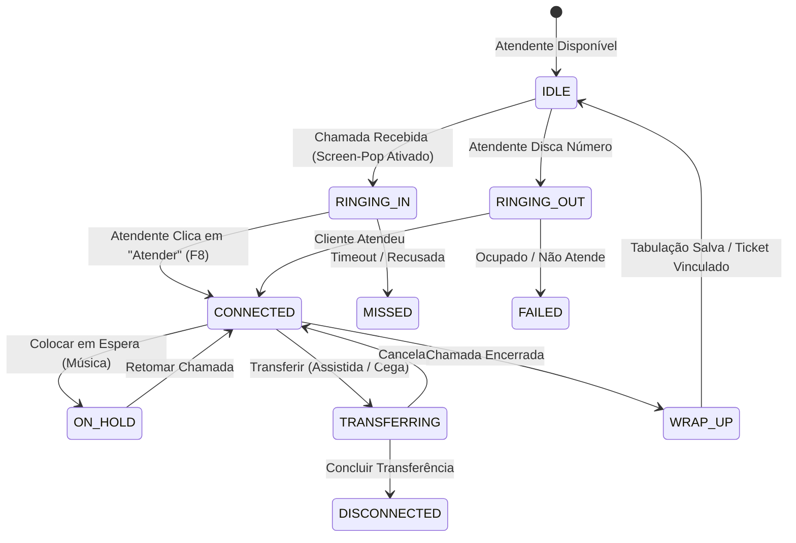

# DeskVoice - Arquitetura do Sistema

Documento mestre de arquitetura técnica da plataforma **DeskVoice**, sintetizando os registros de decisões ([ADR-001 a ADR-006](file:///c:/Users/Lucas/Desktop/Meus%20Projetos%20Git/deskvoice/docs/decisions/README.md)).

---

## 1. Visão Geral

O DeskVoice é uma plataforma desktop e web de atendimento omnichannel, integrando telefonia SIP/WebRTC, CRM contextual com identificação imediata (*Screen-Pop*), gerenciamento de tickets e métricas operacionais em tempo real (TMA, TME, SLA).

```text
┌────────────────────────────────────────────────────────────────────────┐
│ FRONTEND & DESKTOP (TypeScript + SvelteKit 5 + Electron)               │
│ • SvelteKit (Modo SPA Estático com @sveltejs/adapter-static)           │
│ • Design System: Tailwind CSS + shadcn-svelte (bits-ui)                │
│ • Motor de Áudio: WebRTC nativo + JsSIP / sip.js                       │
│ • Camada de Abstração: IPlatformAdapter (Web vs. Electron)             │
│ • Motor de Demonstração: ITelephonyProvider (Mock vs. Sip)             │
└───────────────────────────────────┬────────────────────────────────────┘
                                    │ WebSockets (WSS) + REST API
                                    ▼
┌────────────────────────────────────────────────────────────────────────┐
│ CORE BACKEND (TypeScript + NestJS + Fastify)                           │
│ • Módulos: Auth, CRM, Atendimento/Tickets, Ramais, Relatórios          │
│ • WebSockets Gateway (Presença de Atendentes, Screen-Pop, Eventos)     │
│ • Drizzle ORM + PostgreSQL (Persistência relacional e CDRs)            │
│ • Redis (Estado efêmero de atendentes, Pub/Sub de sinalização)         │
│ • BullMQ (Processamento assíncrono de pós-atendimento e gravações)     │
└───────────────────────────────────┬────────────────────────────────────┘
                                    │ (Sob demanda)
                                    ▼
┌────────────────────────────────────────────────────────────────────────┐
│ SERVIÇO DE IA / PROCESSAMENTO DE ÁUDIO (Python + FastAPI)              │
│ • Transcrição com Whisper / Faster-Whisper                             │
│ • Detecção de Atividade de Voz (Silero VAD)                            │
│ • Sumarização automática do atendimento com LLM                        │
└────────────────────────────────────────────────────────────────────────┘
```

---

## 2. Estrutura do Monorepo

O projeto utiliza **`pnpm workspaces`**:

```text
deskvoice/
├── apps/
│   ├── web/          # Frontend SvelteKit 5 (SPA)
│   ├── desktop/      # Wrapper Desktop Electron
│   └── api/          # Core Backend NestJS
│
├── packages/
│   ├── shared/       # Tipos TypeScript, interfaces de chamada e CallStateMachine
│   ├── database/     # Schemas Drizzle ORM, migrações e clientes de banco
│   └── mock-engine/  # Simulador de eventos de telefonia e chamadas
│
├── docs/
│   ├── decisions/    # Architecture Decision Records (ADRs)
│   └── index.md      # Catálogo de documentação
```

---

## 3. Fluxo e Ciclo de Vida da Chamada

A telefonia é regida por uma máquina de estados estrita (`CallStateMachine`):



---

## 4. Hardware e Áudio: Saída Dupla (*Dual-Output*)

Em centrais profissionais, o sistema controla dispositivos de áudio via `HTMLMediaElement.setSinkId()`:
- **Dispositivo de Campainha:** Alto-falantes do computador (aviso sonoro de chamada entrante).
- **Dispositivo de Conversação:** Fone de ouvido USB / Headset do atendente.
- **Entrada de Microfone:** Microfone do Headset com medidor visual de volume (VU meter).

---

## 5. Licença e Distribuição

- **Repositório Público:** Licenciado sob **Business Source License (BSL 1.1)**.
- **Live Demo:** Executa via Web Browser utilizando o `MockTelephonyProvider` para simulação completa de chamadas sem custos de telecomunicações.
