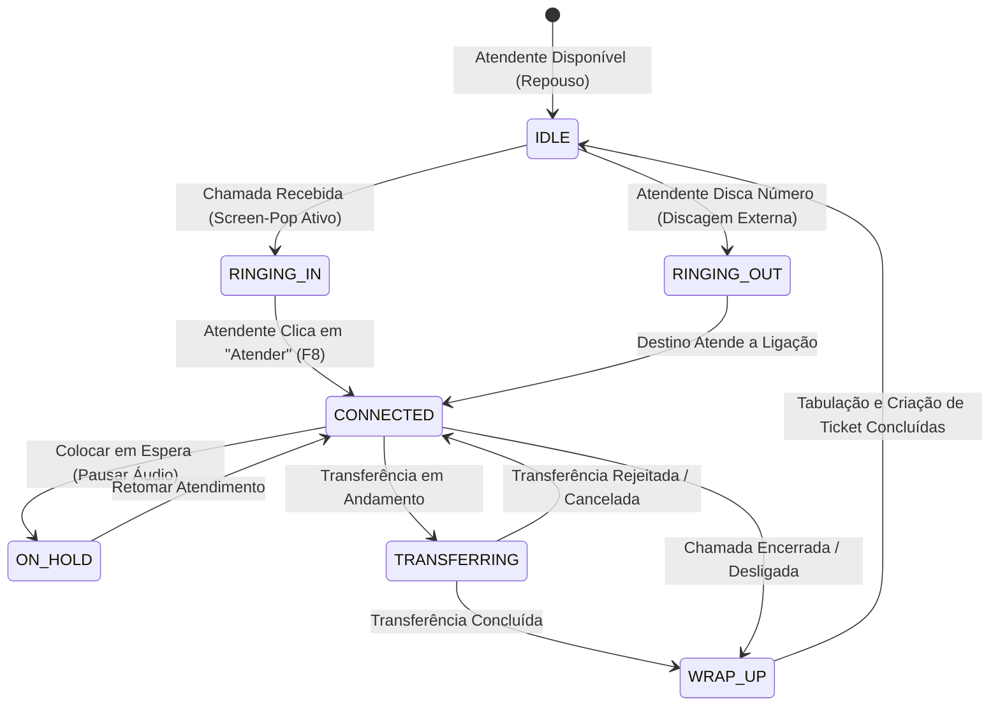

<div align="center">

# 🎧 DeskVoice

**Plataforma Desktop & Web de Atendimento, Telefonia SIP/WebRTC e CRM Contextual**

[](LICENSE.md)
[](https://www.typescriptlang.org/)
[](https://svelte.dev/)
[](https://nestjs.com/)
[](https://orm.drizzle.team/)
[](https://www.electronjs.org/)
[](https://tailwindcss.com/)
[](ARCHITECTURE.md)

<p align="center">
  Uma central de atendimento moderna projetada para transformar o computador do atendente em um posto profissional de comunicação, unificando chamadas de voz, identificação instantânea de clientes (Screen-Pop), tickets e relatórios de SLA em uma única interface.
</p>

</div>

---

## 🌟 Principais Recursos

- ☎️ **Telefonia em Tempo Real (SIP/WebRTC):** Discador DTMF, recebimento de chamadas com toque sintético Web Audio, mudo, chamada em espera (Hold) e transferência de ligações.
- 👤 **Screen-Pop Contextual (CRM Integrado):** No milissegundo em que o telefone toca, o sistema identifica o cliente pelo número, abrindo instantaneamente seu histórico, empresa e notas internas.
- 🎧 **Ergonomia Profissional de Call Center:**
  - *Dual-Output Audio:* Campainha tocando nas caixas de som e áudio da conversa saindo exclusivamente no fone/headset USB.
  - *Atalhos Globais de Teclado:* `F8` para atender, `Esc` para desligar, `Ctrl+M` para mudo e `Ctrl+H` para espera.
  - *Dark Mode First:* Interface escura de alta fidelidade desenhada para reduzir a fadiga ocular em turnos de 8 horas.
- 👥 **Múltiplos Papéis de Acesso (Role-Based Workspace):**
  - **Atendente:** Tela operacional focada no softphone, identificação do cliente e tabulação.
  - **Supervisor:** Monitoria em tempo real dos ramais com recursos de **Escuta Silenciosa** (*Silent Listen*), **Sussurro** (*Whisper Coaching*) e **Intervenção** (*Barge-in*).
  - **Administrador:** Gestão de DIDs corporativos, filas e regras de discagem.
- 📋 **Pós-Atendimento e Tabulação (`WRAP_UP`):** Janela obrigatória após o término da conversa para classificar o motivo da chamada e gerar tickets com protocolo determinístico (`DV-AAAAMMDD-XXXX`).
- 📊 **Métricas Operacionais & Relatórios:** Acompanhamento de TMA (Tempo Médio de Atendimento), TME (Tempo Médio de Espera), registros detalhados de CDR (*Call Detail Record*) e exportação em CSV.
- 🚀 **Live Demo & Showroom Mode:** Motor de simulação isolado (`@deskvoice/mock-engine`) que permite testar a experiência completa sem custos de telecomunicações.

---

## 🏗️ Arquitetura do Sistema

Construído sob as diretrizes do **AI Coding Engineering OS**, o projeto adota um Monorepo modular (`pnpm workspaces`):

```text
deskvoice/
├── apps/
│   ├── web/          # Frontend SvelteKit 5 (SPA Static) + Tailwind CSS 4
│   ├── desktop/      # Shell Electron 35 (Preload Bridge, Context Isolation, Hotkeys)
│   └── api/          # Core Backend NestJS 11 + Fastify + WebSockets Gateway
│
├── packages/
│   ├── shared/       # Contratos, tipos TypeScript, dicionários PT-BR e CallStateMachine
│   ├── mock-engine/  # Simulador de telefonia para testes e Live Demo
│   └── database/     # Schemas Drizzle ORM e migrações PostgreSQL
│
├── docs/
│   ├── decisions/    # Architecture Decision Records (ADRs aceitas 001 a 006)
│   └── index.md      # Catálogo de documentação
```

### Máquina de Estados da Chamada (`CallStateMachine`)

A lógica de transição telefônica é 100% determinística e isolada no `@deskvoice/shared`:



---

## 🔌 Backend & Endpoints da API (`@deskvoice/api`)

O backend foi desenvolvido com **NestJS 11** sobre o adaptador de alta performance **Fastify** e gateway **Socket.IO**:

### REST API
- `GET /health` — Verificação de liveness e status do serviço.
- `GET /crm/customers` — Listagem de clientes da base CRM.
- `GET /crm/customers/lookup?phone=...` — Consulta de cliente por telefone para acionamento do Screen-Pop.
- `POST /crm/customers` — Cadastro de novo cliente.
- `GET /tickets` — Listagem de tickets com suporte a filtros (`?status=OPEN`, `?priority=HIGH`).
- `GET /tickets/:id` — Detalhes de um chamado/ticket por ID ou protocolo.
- `POST /tickets` — Abertura de ticket com protocolo automático.
- `PATCH /tickets/:id/status` — Atualização de status do ticket (`OPEN`, `RESOLVED`, etc.).
- `GET /telephony/active-calls` — Chamadas ativas no PABX em tempo real.
- `GET /telephony/cdrs` — Histórico de bilhetagem detalhada de chamadas (CDR).
- `POST /telephony/simulate-incoming` — Disparo de evento de chamada recebida para teste de integração.

### WebSockets Gateway (`TelephonyGateway`)
- `agent:register` / `agent:status_change` — Sincronização de presença dos atendentes em tempo real.
- `call:start`, `call:answer`, `call:hangup` — Eventos de sinalização de chamada entre cliente e servidor.
- `supervisor:command` — Comandos ao vivo de monitoria supervisória (`LISTEN`, `WHISPER`, `BARGE`).

---

## 🚀 Como Executar Localmente

### Pré-requisitos
- **Node.js:** `>= 20.x`
- **pnpm:** `>= 9.x`

### 1. Clonar e Instalar Dependências
```bash
git clone https://github.com/seu-usuario/deskvoice.git
cd deskvoice
pnpm install
```

### 2. Iniciar a Interface Web (Modo Showroom / Demo)
```bash
pnpm dev
# Acesse: http://localhost:5173
```
*No topo da tela, você pode alternar o **Modo Demo** entre **Atendente**, **Supervisor** e **Administrador** para testar as permissões de tela, além do botão de simulação de chamada VIP.*

### 3. Iniciar o Core Backend (NestJS + Fastify)
```bash
pnpm dev:api
# API disponível em: http://localhost:3000
```

### 4. Iniciar no Desktop (Electron)
```bash
pnpm dev:desktop
```

---

## 🧪 Verificação e Qualidade (AI Coding OS)

O DeskVoice segue o padrão de verificação contínua determinística:

```bash
# Executa type-check em todos os 6 pacotes do monorepo
pnpm check

# Executa bateria de testes unitários com Vitest
pnpm test

# Executa o harness completo de verificação
pnpm verify
```

---

## ⚖️ Licenciamento

Este software é distribuído sob os termos da **Business Source License 1.1 (BSL 1.1)**. 
- O código-fonte está disponível publicamente para fins de aprendizado, avaliação técnica, contratação, auditoria e uso em modo de demonstração pessoal.
- O uso em ambiente de produção comercial ou a oferta deste software como um serviço SaaS/PABX comercial concorrente requer a contratação prévia de uma licença comercial.
- Consulte [LICENSE.md](LICENSE.md) para detalhes completos.
