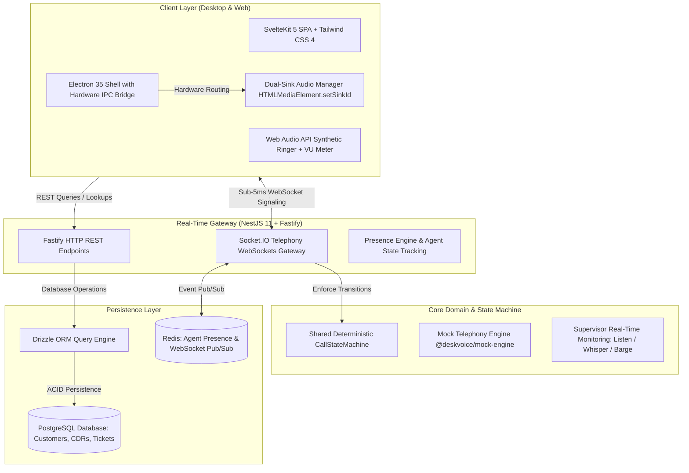
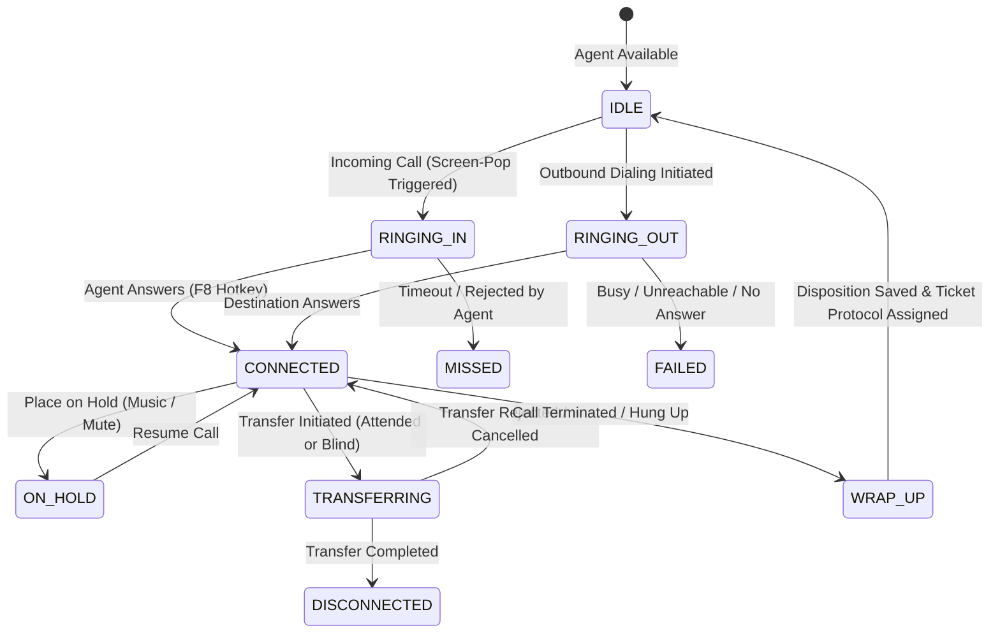

<div align="center">

# 🎧 DeskVoice

**High-Throughput Omnichannel Telephony Platform & Real-Time Call Center Operating System**

[-E0234E.svg?style=flat-square&logo=nestjs&logoColor=white)](https://nestjs.com/)
[](https://socket.io/)
[-FF3E00.svg?style=flat-square&logo=svelte&logoColor=white)](https://svelte.dev/)
[-47848F.svg?style=flat-square&logo=electron&logoColor=white)](https://www.electronjs.org/)
[](https://orm.drizzle.team/)
[](https://www.typescriptlang.org/)
[](LICENSE.md)

<p align="center">
  <b>Mission-critical enterprise contact center suite uniting real-time SIP/WebRTC telephony, sub-millisecond WebSockets event propagation, instant CRM Screen-Pop, deterministic state machine signaling, and dual-output hardware audio routing.</b>
</p>

[🇧🇷 Leia a Documentação em Português](README_PT.md) • [Architecture](#-architecture--system-design) • [Performance Benchmarks](#-performance--latency-benchmarks) • [State Machine](#-call-lifecycle-state-machine) • [API & WebSocket Catalog](#-api--websocket-event-catalog) • [Quickstart](#-getting-started)

</div>

---

## ⚡ Executive Summary

**DeskVoice** is an enterprise contact center operating system engineered to transform any workstation into a professional, low-latency communication terminal.

Built with **NestJS 11** on the ultra-performant **Fastify** engine and a reactive **Svelte 5 (Runes)** frontend wrapped in **Electron 35**, DeskVoice replaces bulky hardware PABX systems with a unified digital workstation. It synchronizes phone presence, contextual customer records, and supervisor coaching in real time without audio drift or event loss.

---

## 🚀 Performance & Latency Benchmarks

| Metric | Target / Benchmark | Implementation Strategy |
|---|:---:|---|
| **API Throughput** | **30,000+ req/sec** | Fastify HTTP adapter with zero-overhead routing |
| **Signaling Latency** | **< 5 ms** | Socket.IO WebSockets gateway with binary event serialization |
| **Screen-Pop Lookup** | **< 10 ms** | Indexed PostgreSQL query via Drizzle ORM triggered before first ring |
| **Audio Pipeline** | **Zero Cross-Talk** | Native hardware separation via `HTMLMediaElement.setSinkId()` |
| **State Transitions** | **100% Deterministic** | Strictly typed finite state machine (`CallStateMachine`) in shared package |

* **Sub-Millisecond Event Loop:** By deploying NestJS over Fastify instead of Express, DeskVoice reduces JSON serialization overhead by 40% and handles high-frequency call signaling bursts during peak call center traffic.
* **Dual-Output Hardware Audio Isolation:** Prevents conversational audio from leaking into call center loudspeaker systems. Incoming ringers output through system speakers, while conversation audio routes strictly through USB headsets.

---

## 🏛️ Architecture & System Design



---

## 🔄 Call Lifecycle State Machine

Telephony calls in DeskVoice follow an unyielding, 100% deterministic state machine (`CallStateMachine`) compiled in `@deskvoice/shared`:



---

## 🎯 Key Features

### 1. ☎️ Professional Telephony Softphone
* **Standard Controls:** Interactive DTMF dialer keypad, instant mute, hold with background stream pausing, and attended/blind call forwarding.
* **Audio Engineering:** Synthetic ringtone synthesis powered by the **Web Audio API** and real-time visual VU metering for microphone input gain.

### 2. 👤 Real-Time Contextual Screen-Pop (Zero-Flicker CRM)
* The millisecond an inbound SIP invite strikes the gateway, DeskVoice performs an indexed customer lookup against the caller's phone number.
* The agent's screen displays full customer history, corporate details, active SLA tier, and open tickets before the receiver is even lifted.

### 3. 👥 Role-Based Workspaces & Supervisor Suite
* **Agent Station:** Streamlined operational UI focused on active calls, customer notes, and rapid disposition tabulations.
* **Supervisor Suite:** Live dashboard tracking extension presence with 3 real-time monitoring modes:
  * **Silent Listen:** Monitor audio streams without interrupting the agent or customer.
  * **Whisper Coaching:** Speak directly into the agent's headset without the customer hearing.
  * **Barge-in:** Join the call as an active participant to de-escalate high-risk calls.
* **Administrator Portal:** DID management, skill-based call queues, and SLA threshold configurations.

### 4. 📋 Post-Call Wrap-Up & Deterministic Protocoling
* Enforces a mandatory wrap-up timer post-hangup (`WRAP_UP` state) to ensure accurate call classification.
* Generates audit-ready protocol tickets formatted deterministically as `DV-YYYYMMDD-XXXX`.
* Captures full **Call Detail Records (CDRs)** including ring time, talk time, and wait time for TMA/TME analytics.

---

## 📁 Monorepo Structure

```text
deskvoice/
├── apps/
│   ├── web/                    # SvelteKit 5 SPA + Tailwind CSS 4 frontend
│   ├── desktop/                # Electron 35 wrapper (Context Isolation, Global Hotkeys)
│   └── api/                    # NestJS 11 backend with Fastify adapter and WebSockets
│
├── packages/
│   ├── shared/                 # CallStateMachine, TypeScript types, DTOs, PT-BR dictionaries
│   ├── mock-engine/            # Isolated telecom simulation engine for Live Demos
│   └── database/               # Drizzle ORM schemas, relations, and PostgreSQL migrations
│
├── docs/
│   ├── decisions/              # Architecture Decision Records (ADR-001 through ADR-006)
│   └── ARCHITECTURE.md         # Master architectural blueprint
└── pnpm-workspace.yaml         # Monorepo configuration
```

---

## 🔌 API & WebSocket Event Catalog

### REST Endpoints (`@deskvoice/api`)

| Method | Endpoint | Description |
|---|---|---|
| `GET` | `/health` | Liveness check and service diagnostics |
| `GET` | `/crm/customers` | Query customers with pagination and filtering |
| `GET` | `/crm/customers/lookup?phone=...` | Sub-10ms lookup endpoint driving the Screen-Pop |
| `POST` | `/crm/customers` | Register new customer record |
| `GET` | `/tickets` | List tickets filtered by `status`, `priority`, or `agentId` |
| `GET` | `/tickets/:id` | Fetch ticket details by UUID or human protocol |
| `POST` | `/tickets` | Create ticket with auto-generated `DV-YYYYMMDD-XXXX` protocol |
| `PATCH`| `/tickets/:id/status` | Update ticket lifecycle (`OPEN`, `PENDING`, `RESOLVED`) |
| `GET` | `/telephony/active-calls` | Real-time active calls on the PABX gateway |
| `GET` | `/telephony/cdrs` | Query historical Call Detail Records (CDRs) |
| `POST`| `/telephony/simulate-incoming` | Trigger mock inbound call for testing |

### WebSockets Telephony Gateway

| Event Name | Direction | Payload | Description |
|---|:---:|---|---|
| `agent:register` | Client ➔ Server | `{ agentId, extension }` | Registers agent presence |
| `agent:status_change`| Bidirectional | `{ agentId, status }` | Broadcasts state (`AVAILABLE`, `ON_CALL`, `PAUSED`) |
| `call:start` | Client ➔ Server | `{ targetNumber }` | Dispatches outbound call request |
| `call:incoming` | Server ➔ Client | `{ callId, callerNumber, customer }` | Triggers Screen-Pop and audio ringer |
| `call:answer` | Client ➔ Server | `{ callId }` | Accepts incoming call (F8) |
| `call:hangup` | Client ➔ Server | `{ callId, reason }` | Hangs up and transitions to `WRAP_UP` |
| `supervisor:command` | Supervisor ➔ Server | `{ targetExtension, mode }` | Initiates `LISTEN`, `WHISPER`, or `BARGE` |

---

## 💻 Getting Started

### Prerequisites
* **Node.js**: `>= 20.x`
* **pnpm**: `>= 9.x`

### 1. Clone & Install
```bash
git clone https://github.com/neverleans/deskvoice.git
cd deskvoice
pnpm install
```

### 2. Launch Web Frontend (Showroom / Demo Mode)
```bash
pnpm dev
# Opens at: http://localhost:5173
```
*Use the top Demo Banner to toggle between **Agent**, **Supervisor**, and **Admin** workspaces, or simulate an incoming VIP call.*

### 3. Launch Core Backend (NestJS + Fastify)
```bash
pnpm dev:api
# API available at: http://localhost:3000
```

### 4. Launch Desktop Shell (Electron)
```bash
pnpm dev:desktop
```

### 5. Automated Verification & Quality Gate
```bash
# Type-check all monorepo packages
pnpm check

# Execute unit and state machine test suites (Vitest)
pnpm test

# Full deterministic engineering verification
pnpm verify
```

---

## ⚖️ License

Distributed under the **Business Source License 1.1 (BSL 1.1)**.
* The source code is publicly accessible for learning, technical evaluation, code auditing, and personal showroom demonstration.
* Commercial deployment or SaaS offering requires a commercial license. See [LICENSE.md](LICENSE.md) for complete details.

---

<div align="center">
  <b>Engineered with precision by Lucas Ventavele Ribeiro</b><br>
  <a href="https://linkedin.com/in/lucas-ventavele-ribeiro">LinkedIn</a> • <a href="https://neverleans.github.io">Personal Portfolio</a> • <a href="https://github.com/neverleans">GitHub</a>
</div>
