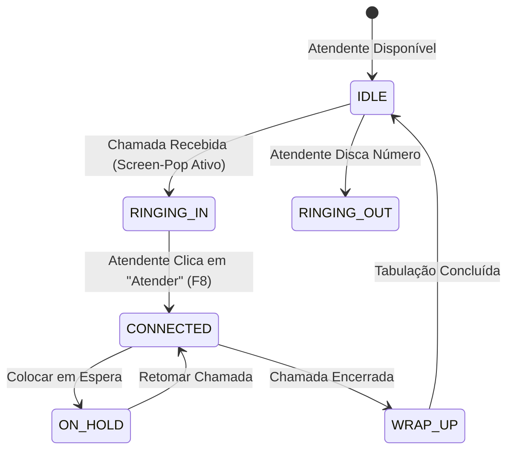

<div align="center">

# 🎧 DeskVoice

**Plataforma Desktop & Web de Atendimento, Telefonia SIP/WebRTC e CRM Contextual**

[](LICENSE.md)
[](https://www.typescriptlang.org/)
[](https://svelte.dev/)
[](https://www.electronjs.org/)
[](https://tailwindcss.com/)
[](ARCHITECTURE.md)

<p align="center">
  Uma central de atendimento moderna projetada para transformar o computador do atendente em um posto profissional de comunicação, unificando chamadas de voz, identificação instantânea de clientes (Screen-Pop), tickets e relatórios de SLA em uma única interface.
</p>

</div>

---

## 🌟 Principais Recursos

- ☎️ **Telefonia em Tempo Real (SIP/WebRTC):** Discador DTMF, recebimento de chamadas, mudo, chamada em espera (Hold) e transferência de ligações.
- 👤 **Screen-Pop Contextual (CRM Integrado):** No milissegundo em que o telefone toca, o sistema identifica o cliente pelo número, abrindo instantaneamente seu histórico, empresa e notas internas.
- 🎧 **Ergonomia Profissional de Call Center:**
  - *Dual-Output Audio:* Campainha tocando nas caixas de som e áudio da conversa saindo exclusivamente no fone/headset USB.
  - *Atalhos Globais de Teclado:* `F8` para atender, `Esc` para desligar, `Ctrl+M` para mudo e `Ctrl+H` para espera.
  - *Dark Mode First:* Interface escura de alta fidelidade desenhada para reduzir a fadiga ocular em turnos de 8 horas.
- 📋 **Pós-Atendimento e Tabulação (`WRAP_UP`):** Janela obrigatória após o término da conversa para classificar o motivo da chamada e gerar tickets com protocolo.
- 📊 **Métricas Operacionais:** Acompanhamento de TMA (Tempo Médio de Atendimento), TME (Tempo Médio de Espera) e taxa de resolução no primeiro contato (FCR).
- 🚀 **Live Demo & Showroom Mode:** Simulador de chamadas embutido (`@deskvoice/mock-engine`) que permite testar a experiência completa sem custos de telecomunicações.

---

## 🏗️ Arquitetura do Sistema

Construído sob os princípios do **AI Coding Engineering OS**, o projeto adota um Monorepo modular (`pnpm workspaces`):

```text
deskvoice/
├── apps/
│   ├── web/          # Aplicação SvelteKit 5 (SPA Static) + Tailwind CSS
│   ├── desktop/      # Shell Desktop Electron (Preload Bridge, Tray, Hotkeys)
│   └── api/          # Core Backend NestJS (WebSockets, CRM, Drizzle ORM)
│
├── packages/
│   ├── shared/       # Contratos, tipos TypeScript e CallStateMachine determinística
│   ├── mock-engine/  # Motor de simulação de telefonia para testes e Live Demo
│   └── database/     # Schemas Drizzle e migrações PostgreSQL
│
├── docs/
│   ├── decisions/    # Architecture Decision Records (ADRs aceitas 001 a 006)
│   └── index.md      # Catálogo de documentação
```

### Máquina de Estados da Chamada



---

## 🚀 Como Executar Localmente

### Pré-requisitos
- **Node.js:** `>= 20.x`
- **pnpm:** `>= 9.x`

### 1. Clonar e Instalar Dependências
```bash
git clone https://github.com/seu-usuario/deskvoice.git
cd deskvoice
pnpm install
```

### 2. Iniciar a Interface Web (Modo Showroom / Demo)
```bash
pnpm dev
# Acesse: http://localhost:5173
```
*Clique no botão **"Simular Chamada (Cliente VIP)"** na barra superior para experimentar o toque de chamada, o screen-pop com os dados do cliente Roberto Alencar, o atendimento e o pós-atendimento!*

### 3. Iniciar no Desktop (Electron)
```bash
pnpm dev:desktop
```

---

## 🧪 Verificação e Qualidade (AI Coding OS)

O DeskVoice implementa o rigor de verificação estrita:

```bash
# Executa type-check em todos os pacotes (TypeScript + svelte-check)
pnpm check

# Executa testes unitários determinísticos com Vitest
pnpm test

# Executa o harness completo de verificação
pnpm verify
```

---

## ⚖️ Licenciamento

Este software é distribuído sob os termos da **Business Source License 1.1 (BSL 1.1)**. 
- O código-fonte está disponível publicamente para fins de aprendizado, avaliação técnica, auditoria e uso em modo de demonstração pessoal.
- O uso em ambiente de produção comercial ou a oferta deste software como um serviço SaaS/PABX comercial concorrente requer a contratação prévia de uma licença comercial.
- Consulte [LICENSE.md](LICENSE.md) para detalhes completos.
